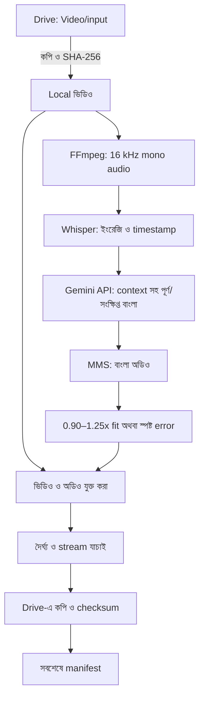

# সিস্টেমের স্থাপত্য

## ১. পরিধি

ইংরেজি কথাসহ ভিডিও থেকে বাংলা dubbing তৈরি হয়। Input: `mp4`, `mkv`, `mov`, `webm`, `avi`, `m4v`। Output: MP4, ইংরেজি/বাংলা SRT এবং পরীক্ষার জন্য JSON। প্রথম non-cover-art video stream ও প্রথম audio stream ব্যবহৃত হয়।

নির্ভুলতা, গতি ও কম memory ব্যবহারের মধ্যে সমন্বয় করা হয়েছে। Speaker আলাদা করা, voice cloning, lip-sync, background music আলাদা করা বা subtitle ছবিতে বসানো এই সংস্করণে নেই।

## ২. Notebook ও worker আলাদা রাখা

Notebook-এ একটি code cell: **ProXMax · Setup ও App**। Colab form view-তে processing code hidden থাকে। **Domain স্থির FC Mobile (`football`)**; dropdown বা আলাদা Start/Cancel button নেই। ▶ চাপলে native `getpass` masked API-key box আসে; key দিয়ে Enter দিলে setup, mount ও worker শুরু হয়। Custom HTML/JavaScript form বা `eval_js` handshake/polling নেই। **Show code** দিয়ে source দেখা সম্ভব—এটি গোপন code রাখার ব্যবস্থা নয়।

```text
Colab kernel: হালকা setup → Drive mount → settings → worker চালানো
                                     │
                      প্রতিবার নতুন Python process
                                     ↓
নিজস্ব venv: FFmpeg → ASR → অনুবাদ → TTS → timeline → mux → প্রকাশ
                                     │
                              process বন্ধ হয়
```

### পুনরায় চালানোর ব্যবস্থা

পুরোনো বিন্যাসে প্রতিবার setup kernel-এর ব্যবহৃত package বদলাতে পারত। একই kernel-এ ML চালালে আগের import/CUDA state-ও থেকে যেতে পারত। নির্দিষ্ট ব্যবহারকারীর traceback ছাড়া এগুলোকেই তাঁর error-এর নিশ্চিত কারণ বলা যায় না; নতুন বিন্যাস এই দুই ঝুঁকি এড়ায়।

- `/content/proxmax-app/venv`-এ `--system-site-packages --without-pip` দিয়ে environment তৈরি হয়। Colab-এর torch/CUDA ও pip দেখা যায়; নতুন inference package শুধু নিজস্ব venv-এ install হয়। Kernel-এ torch/transformers import করা হয় না।
- সফল setup-এর fingerprint রাখা হয়। একই requirements/Python এবং উপযুক্ত installed version থাকলে `pip install` বাদ যায়। পরীক্ষা হয় আলাদা interpreter-এ, kernel-এর পুরোনো module cache থেকে নয়।
- অসম্পূর্ণ install-এর completion marker থাকে না; পরের run আবার চেষ্টা করে। Requirements বদলালে setup পুনরায় যাচাই হয়।
- প্রতিটি অনুবাদ run নতুন process পায়। শেষ/ব্যর্থ হওয়ার পর process বন্ধ হয়; পরের worker পুরোনো CUDA context পায় না। এটি ভাঙা driver, অপর্যাপ্ত GPU memory বা network সমস্যা নিজে ঠিক করে না।
- Config stdin pipe দিয়ে worker-এ যায়; structured result stdout pipe দিয়ে memory-তে ফেরে। Parent protocol JSON লুকিয়ে শুধু মানুষের পড়ার মতো progress/error দেখায়। কোনো config/result/log ফাইল লেখা হয় না; প্রতি run-এর outcome নতুন করে শুরু হয়, তাই পুরোনো সফল ফলাফল পুনর্ব্যবহার হয় না।
- Notebook interrupt করলে process group-এ SIGTERM দেওয়া হয়; প্রয়োজন হলে SIGKILL। Worker ও তার FFmpeg subprocess বন্ধ হয়। Checkpoint মুছে ফেলা হয় না।
- Drive-এর mount ও `MyDrive` পড়া যায় কি না যাচাই হয়। সক্রিয় mount পুনর্ব্যবহার হয়; সাধারণ local folder-কে Drive ধরা হয় না। নষ্ট সংযোগে ব্যবহারকারী `Show code` থেকে `REMOUNT_DRIVE=True` করতে পারেন; জোর করে mount ভাঙা হয় না।

Notebook-এর setup ও UI helper (`colab_ui.py`), ভাষা helper (`language.py`), API client (`gemini.py`), pipeline ও worker source notebook-এই থাকে। Repository clone বা দূরের executable code আনা লাগে না। Generator ছয়টি source-ই হালনাগাদ করে। Worker-এ অপ্রয়োজনীয় TensorFlow/Flax backend import বন্ধ রাখা হয়; torch/CUDA বদলায় না।

## ৩. ডেটার প্রবাহ ও অবস্থান



| অবস্থান | কী থাকে |
|---|---|
| `/content/drive/MyDrive/Video/input` | ব্যবহারকারীর মূল ভিডিও |
| `/content/proxmax-work/<job>` | local video, WAV, checkpoint, clip ও output |
| `/content/proxmax-model-cache` | model/tokenizer cache |
| `/content/proxmax-app` | venv ও embedded source; error/log ফাইল নয় |
| `/content/drive/MyDrive/Video/output/<job>` | সম্পন্ন ফলাফল |

ভারী কাজ local file নিয়েই হয়। Input কপি করার সময়েই hash হয়, আলাদা করে Drive থেকে আবার পুরো input পড়তে হয় না। Output checksum যাচাইয়ের জন্য Drive-এ লেখা temporary file পড়া হয়; নির্ভরযোগ্যতার জন্য এই অতিরিক্ত I/O রাখা হয়েছে।

## ৪. Pipeline-এর ধাপ

### ক. ভিডিও আনা ও audio extraction

- সমর্থিত extension-এর ভিডিও সরাসরি input folder থেকে নেওয়া হয়; subfolder নয়।
- input/output/work path আলাদা রাখা, খালি disk এবং পরিবর্তনশীল input যাচাই করা হয়। 6 GiB margin ও media-ভিত্তিক অনুমান ব্যবহৃত হয়; এটি সব আকারের ভিডিওর storage নিশ্চয়তা নয়।
- Job ID-তে নিরাপদ filename, content hash, inference setting ও package version-এর hash থাকে।
- local input-এ ffprobe চলে; finite duration ও ভিডিও stream প্রয়োজন। Audio stream না থাকলে স্পষ্ট error হয়।
- FFmpeg mono PCM16, 16 kHz তৈরি করে। `aresample=async=1:first_pts=0` দিয়ে audio delay/ফাঁক সামলানো হয়। গুরুতর নষ্ট বা discontinuous timestamp আগে মেরামত করতে হতে পারে।

### খ. ইংরেজি speech recognition

Model: `mobiuslabsgmbh/faster-whisper-large-v3-turbo`—[faster-whisper v1.2.1-এর registry](https://github.com/SYSTRAN/faster-whisper/blob/v1.2.1/faster_whisper/utils.py) অনুযায়ী। পুরোনো ভুল `Systran/faster-whisper-large-v3-turbo` এবং `turbo`/`large-v3-turbo` alias সংশোধন করা হয়। `language="en"`, `task="transcribe"`; Whisper-এর translation mode নয়।

- ASR, optional NLLB ও TTS-এর public download-এ `token=False`; পুরোনো invalid cached token ব্যবহার হয় না। Worker implicit token-ও বন্ধ রাখে। Private/gated model-এর authentication এই সংস্করণের বাইরে। ASR-এ HTTP 401/403/404 হলে model ID/revision-সহ স্পষ্ট error ও original traceback দেখায়, নীরবে অন্য model ব্যবহার করে না।
- FFmpeg-এর তৈরি 16 kHz mono WAV `soundfile` দিয়ে contiguous `float32` array হিসেবে পড়া হয়। Sample rate, channel, খালি audio ও NaN/Inf যাচাইয়ের পরে সেই array Whisper-এ যায়; PyAV দিয়ে একই file আবার decode হয় না। এতে `av.open(metadata_errors=...)` API mismatch-এর পথটি এড়ানো হয়।
- Dependency সামঞ্জস্যের জন্য `av==16.0.1` pin করা হয়েছে; এই সংস্করণে `metadata_errors` আছে এবং Python 3.13 Linux wheel-ও পাওয়া যায়। PyAV-এর সংস্করণও output manifest-এর package তালিকায় থাকে।
- CUDA-তে পছন্দ `int8_float16`, CPU-তে `int8`; প্রয়োজন হলে সমর্থিত floating-point type।
- Word timestamp, beam size 5, VAD এবং 500 ms silence threshold।
- আগের text-এর conditioning বন্ধ, যাতে repetition ছড়ানোর ঝুঁকি কমে; কিছু দীর্ঘ context হারায়।
- 12 সেকেন্ড/40 word soft target; বাক্য/বিরতি/clause-এ নিরাপদ cut খোঁজে। নামের জোড়া ও negation/function word-এর পরে cut এড়ায়। 24 সেকেন্ড/80 word hard limit-এ জোর করে cut হলে `boundary_review` থাকে। একক দীর্ঘ word-এর timestamp বানানো হয় না।
- 2 সেকেন্ডের কম reaction-phrase সর্বোচ্চ 0.35 সেকেন্ড gap-এ, সীমা মেনে আগের phrase-এ মেশে। 0.65 সেকেন্ড gap phrase boundary-র একটি সংকেত।
- `domain="football"` হলেই ASR prompt-এ football hint যায়। Raw ASR অক্ষত থাকে; normalization/alias corrections ও অস্পষ্ট নামের review তথ্য আলাদা থাকে। `general`-এ কোনো football replacement হয় না।
- Word probability ও segment diagnostic `asr.json`-এ থাকে; এগুলো নিশ্চিত accuracy score নয়।
- নীরব/অতি ক্ষীণ কথায় VAD ভুল করতে পারে। কোনো কথা না পেলে নীরব output ও warning হয়।

### গ. বাংলা অনুবাদ

Default: Google AI Studio key দিয়ে **`gemini-3.5-flash-lite`**, batch 4। Local Qwen load হয় না; stdlib HTTPS REST client ব্যবহৃত হয়, আলাদা Gemini SDK dependency নেই। ASR/TTS এখনও local।

- `v1beta/models/{model}` দিয়ে কাজের আগে exact ID/key/access যাচাই; 404/permission failure হলে স্পষ্ট error, কোনো model fallback নয়। এই model-এর live availability এখানে যাচাই করা হয়নি।
- `countTokens` দিয়ে পুরো generation request-এর input budget যাচাই; `generateContent`-এ system instruction, JSON MIME type/schema, temperature 0 ও output limit পাঠানো হয়। API output সম্পূর্ণ deterministic হওয়ার নিশ্চয়তা নেই।
- 429/সাময়িক 5xx/network failure-এ সর্বোচ্চ দুই retry ও bounded backoff; 401/403/404-এ retry নয়। Timeout 120s প্রতি HTTP attempt; rate-limit wait 60s ছাড়ালে থামে। Retry/হারানো response-এর জন্য পুনরায় চার্জ হতে পারে।
- API error body/headers/raw exception প্রকাশ করা হয় না। Auth শুধু `x-goog-api-key` header-এ; URL/query-তে নয়। Redirect বন্ধ। Blocked/empty/non-STOP/MAX_TOKENS response গ্রহণ করা হয় না।

- আগের/পরের একটি phrase শুধু context; target cue-গুলোই অনুবাদ করতে হবে। Cue-এর সময়, glossary ও strict JSON schema দেওয়া হয়। Transcript-কে instruction নয়, data হিসেবে চিহ্নিত করা হয়।
- একই generation call-এ পূর্ণ `bangla` ও ছোট `bangla_concise` তৈরি। সংখ্যা, নাম, negation, তুলনা, শর্ত ও তথ্য রাখতে বলা হয়; শুধু filler কমানো যায়। Prompt নির্দেশ দিলেই অর্থ সংরক্ষিত হয়েছে—এমন নিশ্চয়তা নেই।
- JSON ID/order, nonempty Bengali, digit/সংখ্যার একক, negation ও glossary checks। JSON বা checks খারাপ হলে default আরও একবার corrective generation। এই corrective retry HTTP retry থেকে আলাদা; দুটিই bounded।
- প্রতিটি schema-valid batch `translation_progress.json`-এ atomic checkpoint হয়; পরের run-এ signature ও ID/order যাচাই করে সম্পন্ন batch পুনর্ব্যবহার করে। Key/error body checkpoint-এ থাকে না।
- source/context token limit ছাড়ালে বা output generation limit ছুঁলে error; চুপচাপ truncation নয়। বৈধ schema পেলে candidates ও checks `translation.json`-এ checkpoint হয়, যাতে মানুষ সংশোধন করতে পারেন।
- TTS-এর আগে checks আবার চলে; manual edit পুরোনো checks দিয়ে আটকে থাকে না। দুই candidate-ই খারাপ হলে model না চালিয়ে ID-সহ error। একটি বৈধ হলে শুধু সেটি বিবেচিত হয়।
- `football` profile-এ glossary-ভিত্তিক বানান ও idiom সংশোধন; raw ইংরেজি বদলায় না। অস্পষ্ট player বা source-এর পরস্পরবিরোধী 942 million/942 billion-কে যাচাই ছাড়া একই সংখ্যা করা হয় না।
- `translation_backend="nllb"` ও `translation_model="facebook/nllb-200-distilled-600M"` দিলে আগের ছোট model; `eng_Latn → ben_Beng`, beam 3, GPU FP16/CPU FP32। এই mode-এ context/আলাদা concise generation নেই; একই quality ও speed guards প্রযোজ্য।

Checks conservative heuristic—সম্পূর্ণ semantic যাচাই নয়। সংখ্যা digit আকারে রাখতে ও million/crore conversion না করতে বলা হয়; কিছু বৈধ paraphrase/বানানও আটকে যেতে পারে। Missing clause ও অজানা নাম পুরোপুরি ধরা যায় না। বাংলা জানা মানুষের review প্রয়োজন।

### ঘ. বাংলা speech synthesis

Model: `facebook/mms-tts-ben`, Transformers VITS।

- নিজস্ব একটি কণ্ঠ; hosted TTS service বা key লাগে না। Tokenizer চাইলে reusable `uroman` দিয়ে romanization হয়।
- Subtitle-এর digit আলাদা রেখে TTS-এ integer/decimal/ordinal বাংলা কথায় বিস্তৃত হয়; `tts_text` নথিভুক্ত হয়। Tokenizer-এর vocabulary থেকে digit বাদ পড়লেও সংখ্যাটি হারায় না। Phone/date/code-এর বিশেষ পাঠ নির্ভুল ধরা যাবে না।
- সর্বোচ্চ 220 character-এর word/sentence-ভিত্তিক chunk; কথা বাদ পড়ে না। খুব বড় একক token হলে error হয়।
- VITS স্থিতিশীলতার জন্য FP32-তে চলে। Seed phrase-ভিত্তিক; অন্য hardware/version-এ একই byte-এর output নিশ্চিত নয়।
- খালি, নীরব বা nonfinite waveform error দেয়। খুব নিচু level-এর বাইরের silence বাদ দিতে audible content-এর দুপাশে 50 ms guard থাকে; ভেতরের pause কাটা হয় না। Peak বেশি হলে কমানো হয়; এটি পূর্ণ loudness normalization নয়।
- পূর্ণ candidate-এর measured TTS না ধরলে সংক্ষিপ্ত candidate তৈরি/মাপা হয়। Gemini-তে candidates আগেই তৈরি হয়; প্রতি clip-এ নতুন API call বা local LLM load হয় না।
- Output-এর `bangla`/বাংলা SRT-তে আসলে বলা সংস্করণ, `bangla_full`-এ পূর্ণ reference, `spoken_variant`-এ নির্বাচন থাকে। TTS/raw/speech/slot duration ও edge-silence removal আলাদা নথিভুক্ত হয়।
- প্রতিটি fitted clip-এর text/timing/recipe signature ও checksum থাকে। অনুবাদের একটি phrase বদলালে শুধু সেই clip পুনরায় তৈরি হয়।

### ঙ. সময় মেলানো

```text
start       = ইংরেজি phrase-এর শুরুর সময়
slot_end    = min(ভিডিওর শেষ, পরের phrase-এর শুরু, phrase-এর শেষ + 0.30 সেকেন্ড)
slot_length = round(slot_end × sample_rate) − round(start × sample_rate)
speed       = clamp(বাংলা অডিওর দৈর্ঘ্য / slot-এর দৈর্ঘ্য, 0.90, 1.25)
না ধরলে     = সংক্ষিপ্ত candidate পরীক্ষা; সেটিও ব্যর্থ হলে প্রকাশ নয়
```

- শুধু পরের অব্যবহৃত silence থেকে সর্বোচ্চ 0.30 সেকেন্ড নেওয়া হয়; পরের phrase-এর সঙ্গে overlap নয়।
- ছোট speech সর্বনিম্ন 0.90× পর্যন্ত ধীর হতে পারে; শেষে silence বসে। বড় speech-এর জন্য pitch-preserving `atempo` সর্বোচ্চ 1.25×।
- Default `error`; legacy `stretch`-ও hard cap মানে। Config, fitting retries, cached clips ও timeline assembly-তে speed bounds যাচাই হয়।
- `atempo` sample-exact নয়। সর্বোচ্চ চারটি fit attempt-এ rate কেবল cap পর্যন্ত বাড়তে পারে; cap-এও বড় থাকলে `TimingOverflow`। **speech crop, overlap বা গোপনে cap বাড়ানো হয় না**।
- সব failed cue ID terminal-এ আসে; সফল clip রেখে job প্রকাশ বন্ধ থাকে। অর্থ অক্ষত রেখে সংক্ষিপ্ত লেখা সম্ভব না হলে fixed timeline ও এই cap একসঙ্গে রক্ষা করে output দেওয়া সম্ভব নাও হতে পারে।
- প্রতিটি clip নিজের absolute sample position-এ disk-backed int16 timeline-এ বসে। Overlap ও video boundary যাচাই হয়।
- WAV 30 সেকেন্ডের block-এ লেখা হয়। এতে পুরো output audio RAM-এ রাখতে হয় না; Whisper-এর input audio কিন্তু RAM ব্যবহার করে।

এটি phrase-onset alignment, lip-sync নয়। অনুবাদে শব্দের ক্রম/দৈর্ঘ্য বদলায়; মুখের প্রতিটি নড়াচড়া মেলানো হয় না।

### চ. ভিডিও তৈরি ও প্রকাশ

- H.264 stream সম্ভব হলে copy; অন্য codec বা copy ব্যর্থ হলে `libx264`, `veryfast`, CRF 20, YUV420p।
- বাংলা mono AAC, 96 kb/s, language `ben`; MP4 fast-start। মূল ইংরেজি/গান/পরিবেশের audio রাখা হয় না। পুরোনো subtitle, metadata ও chapter কপি হয় না।
- video/audio stream ও মোট duration যাচাই করা হয়; packet/frame rounding-এর জন্য 250 ms tolerance। শুধু container duration দিয়ে বাস্তব speech sync যাচাই হয় না।
- Output, subtitle ও JSON temporary sibling-এ কপি করে checksum মেলানো হয়, তারপর rename। **সবশেষে `manifest.json`** লেখা হয়।

Manifest-last একটি completion protocol, বহু ফাইলের atomic transaction নয়। পুনরায় প্রকাশের আগে পুরোনো completion marker সরানো হয়। Mount checksum server-side তাৎক্ষণিক durability বা একসঙ্গে একাধিক writer-এর নিরাপত্তা নিশ্চিত করে না।

## ৫. Resource ও recovery

এক সময়ে এক model এবং এক ভিডিও চলে। Stage শেষে model মুছে garbage collection/PyTorch cache পরিষ্কার হয়; batch শেষে worker-ই বন্ধ হয়। বারবার model load-এর কিছু সময় লাগে, কিন্তু একসঙ্গে GPU-তে সব model থাকে না।

Checkpoint-এর ক্রম:

```text
local input → asr.json → translation_progress.json → translation.json
                                                     → clips/*.wav + metadata
                                           → timeline → mux → Drive
```

- JSON-এ temporary write ও rename। অসম্পূর্ণ ASR ধাপ আবার চলে; Gemini অনুবাদে batch ধরে এবং TTS-এ clip ধরে resume হয়। NLLB-এর অসম্পূর্ণ translation ধাপ পুরোটা আবার চলে।
- Operational path/cleanup/timeout বদল inference recipe বদলায় না। Content বা inference setting বদলালে আলাদা job।
- Local model commit manifest-এ থাকে; `*_revision` দিয়ে এগুলো pin করা যায়। Gemini-তে Hub commit নেই: `translation_api`-তে requested ID, response-এর model version ও token usage থাকে। Usage চূড়ান্ত bill নয়; alias-এর ভবিষ্যৎ পরিবর্তন বন্ধ করা যায় না।
- নষ্ট JSON/timestamp error দেয়; নীরবে উপেক্ষা করে না। প্রয়োজন হলে সংশ্লিষ্ট local checkpoint সরিয়ে আবার তৈরি করুন।
- Notebook-এ `keep_local=True`; local `translation.json`-এর `bangla` ও `bangla_concise` সংশোধন করা যায়। ID/time বদলাবেন না। নতুন text/signature হলে সেই clip পুনরায় হয়; stale quality flags নয়, বর্তমান text আবার যাচাই হয়।
- Pipeline 2.1.0 recipe পুরোনো unbounded-speed checkpoint পুনর্ব্যবহার করে না। `quality_status=human_review_required`: rendering complete বা কোনো review flag না থাকা মানেই semantic accuracy নয়।
- ব্যর্থতার stage/error ও traceback terminal-এ আসে; `failure.json`, `batch_results.json` বা run log লেখা হয় না। Checkpoint থাকে, error report নয়। পরের ভিডিও default-ভাবে চলতে পারে। সফল local job কেবল verified publication-এর পরে মুছে যায়।
- সফল output থাকলেই পরের run সেটি বাদ দেয় না। Input hash আবার যাচাই হয়; checkpoint না থাকলে কাজ আবার হয়।
- Runtime হারালে venv, model cache ও local checkpoint হারায়। Drive-এর সম্পন্ন ফলাফল থাকে। Checkpoint ক্রমাগত Drive-এ sync করা হয় না, যাতে latency না বাড়ে।

Core package pin আছে, সম্পূর্ণ Colab image lockfile নয়। বর্তমান stack CUDA 12/cuDNN 9 লক্ষ্য করে। Colab image বদলালে বাস্তব পরীক্ষা ও প্রয়োজনমতো pin বদল জরুরি। Gemini translation GPU-independent; CPU-তে ASR/TTS ধীর। API ছাড়া চালাতে NLLB backend/model স্পষ্টভাবে বেছে নিতে হয়; error ঢাকতে নীরবে model/device বদলানো হয় না।

Gemini translation-এর local model memory লাগে না; API latency/quota/billing নতুন trade-off। Batch 4, সীমিত context, per-batch translation checkpoint ও clip cache ব্যবহার হয়। Local ASR/TTS sequential থাকে। নতুন API profile-এর live speed/Bengali voice benchmark হয়নি।

Manifest-এর stage time কেবল বর্তমান run-এর সময়—cache hit-সহ। Download, warm inference ও resume-এর সময় আলাদা না করে benchmark তুলনা করবেন না। নির্দিষ্ট speed/accuracy দাবি করা হয়নি।

## ৬. নিরাপত্তা, লাইসেন্স ও পরীক্ষা

- Drive authentication Colab পরিচালনা করে। Credential code-এ রাখা হয় না।
- Gemini mode-এ transcript/context/time budget/glossary/corrective feedback Google-এ যায়; raw video/audio যায় না। Google-এর প্রযোজ্য data retention/use ও billing terms ব্যবহারকারীকে যাচাই করতে হবে। Local model download Hugging Face থেকে; Colab নিজেও cloud VM।
- Notebook native `getpass` masked API-key box নেয়; key Colab `@param`, HTML source বা saved widget state নয়। Echo-safe input না পেলে plain-text fallback বন্ধ করে error দেয়। Domain notebook Config-এ `football` হিসেবে স্থির; generic CLI/core-এ `general` বিকল্প অপরিবর্তিত। Enter দেওয়ার পরেই setup/API শুরু হয়; custom browser form/Promise/polling নেই। Python-এ success/error/interrupt-এর পর key reference পরিষ্কার হয়। Key Config বা file-এ নয়, child environment দিয়ে worker memory-তে যায়। Worker environment থেকে key সরায়; FFmpeg সেটি পায় না। Parent terminal output-এ key redaction-ও থাকে। প্রতি run-এ নতুন input; source/output/checkpoint-এ credential সংরক্ষণ হয় না।
- `trust_remote_code=False`, torch 2.6+; FFmpeg argument-list দিয়ে চলে, filename shell-এ বসানো হয় না।
- Transcript, local checkpoint, terminal output ও ভিডিও ব্যক্তিগত তথ্য বহন করতে পারে। প্রকাশ্য repository-তে রাখবেন না।
- NLLB/MMS-এর CC-BY-NC-4.0 non-commercial সীমা প্রযোজ্য; code license সেটি বদলায় না। Model card-এর link README-তে আছে।

Test suite ও test-only CI repository থেকে সরানো হয়েছে। Source বদলানোর পরে `python scripts/build_notebook.py --check` দিয়ে notebook হালনাগাদ আছে কি না দেখুন। বাস্তব ব্যবহার যাচাই করতে Colab-এ ছোট ভিডিও দিয়ে model download, GPU/CPU, বাংলা উচ্চারণ, timing ও Drive output পরীক্ষা করুন; source validation দিয়ে এগুলো নিশ্চিত হয় না।
