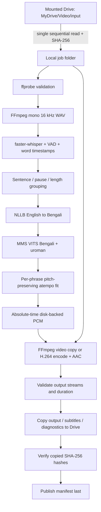

# System architecture blueprint

## 1. Scope and design goals

**Input:** common video containers (`mp4`, `mkv`, `mov`, `webm`, `avi`, `m4v`) with English speech in their first audio track. **Output:** browser-oriented MP4 with a generic Bengali dub plus English/Bengali SRT and diagnostics.

The three competing goals are accurate recognition/translation, short processing time, and bounded Colab resource use. This design avoids claiming all can be maximized simultaneously. It chooses:

- Strong English ASR with a turbo Whisper checkpoint and quantized GPU inference.
- A relatively small local multilingual translation model rather than a much larger LLM.
- Lightweight, offline-capable Bengali TTS rather than a hosted voice API or voice-cloning system.
- Sequential stages and videos rather than multiple competing GPU workers.
- Fast video stream-copy when feasible rather than always re-encoding picture frames.

The initial scope deliberately excludes speaker diarization, background/music separation, lip-sync, subtitle burn-in, language detection/routing, and a web service. Multiple speakers share one voice.

## 2. Dataflow and storage boundaries



| Storage | Contents | Lifetime |
|---|---|---|
| `/content/drive/MyDrive/Video/input` | Original uploads, read-only to the pipeline | User-controlled |
| `/content/proxmax-model-cache` | Hugging Face public weights/tokenizers | Colab runtime |
| `/content/proxmax-work/<job>` | Local input, WAVs, checkpoints, temporary output | Failed jobs retained; successful jobs removed by default |
| `/content/drive/MyDrive/Video/output/<job>` | Complete output bundle | User-controlled |

The requested logical `drive/Video/...` paths correspond to **My Drive**, not the mount root itself. A Drive mount exposes `MyDrive` and potentially Shared Drives. Shared Drives require explicit path overrides.

Every expensive operation consumes **local files**. Drive is used only to stage inputs and publish completed artifacts/summary. SHA-256 is computed while copying input, so there is no second whole-file read from Drive. Output publication intentionally reads back each temporary Drive file to verify its bytes; this adds bounded output I/O for reliability.

## 3. Stage contracts

### A. Discovery, staging, and preflight

- Non-recursive, sorted discovery of supported extensions; one video at a time.
- Validate directory separation and ensure work is not under `/content/drive`.
- Reserve disk for input/output plus a configurable 6 GiB margin; refine estimates after probing duration.
- Copy input to a temporary local file, compute content hash, and reject source files changed during staging.
- Rename into a job directory identified by safe filename, content hash and configuration/dependency recipe hash.
- Probe the local media, choose the first non-cover-art video and first audio stream, and require finite duration.
- Missing/unsupported media yields a clear failure; originals are never changed.
- Extract mono PCM16 at 16 kHz. `aresample=async=1:first_pts=0` fills gaps/initial audio delay on the input media timeline. Common delayed-audio cases are covered by a synthetic-media test; badly damaged/discontinuous streams remain out of scope.

### B. English speech recognition

**Default:** `Systran/faster-whisper-large-v3-turbo` using faster-whisper/CTranslate2.

- Force `language="en"` and `task="transcribe"`; Whisper's translation mode is not used.
- GPU: prefer `int8_float16`, falling back to a supported floating-point type. CPU: prefer `int8`.
- Word timestamps, beam size 5 and VAD with a 500 ms silence threshold.
- Disable previous-text conditioning to reduce repetition propagation; this sacrifices some long-range context.
- Consume the lazy generator before unloading the model.
- Preserve word probabilities, segment average log probabilities and no-speech estimates in `asr.json` for human inspection. These are diagnostics, not calibrated quality guarantees.
- Form phrases using sentence boundaries, gaps ≥ 0.65 seconds, a 12-second target limit and a 40-word limit. A single unusually long ASR word/fallback segment cannot be split without inventing timings; token overflow then fails explicitly downstream.

No-speech detection is not proof that no speech exists: VAD can miss quiet/faint speech. Empty ASR produces silence and a manifest warning rather than fabricated Bengali content.

### C. English-to-Bengali translation

**Default:** `facebook/nllb-200-distilled-600M`, `eng_Latn → ben_Beng`.

- NLLB source language is set on the tokenizer; Bengali is forced as the target language token.
- Batches of four phrases; three translation beams; CUDA FP16 or CPU FP32.
- No silent source truncation: excessive token count raises an actionable error.
- Reject generation at the token limit, including a forced end token at the limit.
- Reject empty/non-Bengali outputs rather than silently speaking the English source.
- Save completed translation stage atomically to `translation.json`, then unload the model.

Translating bounded phrases trades document-level context for precise timestamp slots and lower memory. Sentence grouping helps context but does not eliminate ambiguity. Proper names, numbers, code, abbreviations, idioms and domain terminology require review. A Bengali-script check detects an obvious language failure, not translation correctness.

### D. Bengali speech synthesis

**Default:** `facebook/mms-tts-ben` with Transformers VITS.

- Local, single-voice TTS. No API key and no remote speech endpoint.
- Reuse one `uroman` Romanizer when required by the checkpoint tokenizer; Bengali romanization is applied before tokenization.
- Split long synthesis text at words/sentence endings (maximum 220 Unicode characters) without dropping words.
- Generate chunk audio at the checkpoint's native sample rate; concatenate only within one bounded phrase.
- VITS remains FP32 for stability; seed by phrase for repeatability within a compatible environment. Hardware/library changes may still affect numerical output.
- Peak attenuation prevents clipping; this is not broadcast loudness normalization.
- Tokenless, empty, nonfinite or silent generated speech fails explicitly.
- Cache each completed fitted clip and its checksum with a signature of text, timing and inference recipe. An edited local Bengali phrase invalidates only that phrase's TTS cache.

A first-time voice download still requires internet. Once cached, the synthesis does not depend on an online voice service. The voice has limited expressiveness and cannot preserve speaker identity or emotion.

### E. Timing and synchronization

For source phrase `i`:

```text
start_i      = original English phrase start
slot_end_i   = min(video duration,
                   next phrase start,
                   English phrase end + 0.30 seconds)
slot_samples = round(slot_end_i × sample_rate) - round(start_i × sample_rate)
raw_duration = synthesized Bengali duration
speed        = max(1, raw_duration / slot_duration)
```

- Borrow only limited unoccupied following silence; never overlap the next phrase.
- Short speech keeps its natural rate and is padded with silence (not slowed to fill space).
- Longer speech uses FFmpeg `atempo`, factored into 0.5–2.0 steps to avoid extreme single-filter factors.
- The default `stretch` policy retains all speech, flags rates above 1.50× and may sound rushed.
- Optional `error` policy refuses a fit exceeding that comfort threshold; human shortening/editing is required.
- FFmpeg tempo fitting is not sample-exact. If an output is still too long, retry a slightly faster rate up to a bounded limit. **Never crop speech samples to hide overflow.** Pad the remaining difference to an exact sample count.
- Place each clip directly at its absolute sample position in a disk-backed PCM timeline. Enforce non-overlap and video-length bounds before assignment.
- Stream the timeline to WAV in 30-second blocks; no whole-video float waveform is held for final assembly.
- Video duration and Bengali audio duration are validated within 250 ms after AAC muxing; normal packet/frame rounding is tolerated. This is not a lip-sync accuracy guarantee.

Phrase onset alignment avoids cumulative drift but does not reproduce phoneme-to-mouth timing. Word-level alignment within a translated sentence is linguistically different and is not attempted.

### F. Render and publication

- Copy H.264 video bitstream to MP4 when possible: no picture encode cost or generational loss.
- Other codecs, or a failed stream-copy, fall back to CPU `libx264`, `veryfast`, CRF 20, even dimensions and YUV420p.
- Map only the selected picture and the generated mono Bengali audio. The English soundtrack and other source audio/subtitle tracks are not mixed/copied.
- Encode AAC at 96 kb/s, mark language `ben`, set MP4 fast-start, and retain total source duration.
- Drop original metadata and chapters instead of carrying potentially incorrect English/audio metadata.
- Validate video/audio presence and duration before writing the local final name.
- Export source/Bengali SRT, segment JSON, ASR diagnostics and a manifest with source hash, settings, package versions, resolved model commits, per-stage timing and review flags.
- Copy each artifact to a unique temporary sibling on Drive, compare SHA-256 with local content, then rename it to the final filename. Publish `manifest.json` last.

The completion marker is a protocol, not a multi-file atomic transaction. Readers must require it. A prior marker is removed before republishing a bundle. A failure during publication leaves no misleading completed marker and retains local results. Drive's FUSE semantics cannot guarantee immediate remote durability or protect against simultaneous independent writers; concurrent runs on the same directories are unsupported.

## 4. Memory, throughput and operational behavior

| Stage | Resource strategy | Main tradeoff |
|---|---|---|
| ASR | Turbo model, quantized CTranslate2, VAD, one worker | Full source audio/features still consume host RAM |
| Translation | 600M checkpoint, FP16 on GPU, bounded batches | Phrase context and beam search affect quality/speed |
| TTS | Small local VITS, short chunks, cached Romanizer | Single voice; FP32 consumes more memory than FP16 |
| Assembly | int16 disk-backed timeline, block WAV writer | Requires temporary local disk proportional to duration |
| Rendering | H.264 stream-copy; constrained-thread fallback | Unsupported codecs need expensive picture re-encoding |
| Scheduling | One model/stage and one video at a time | Repeated model loading between videos adds latency |

Models are deleted in `finally` blocks; garbage collection and PyTorch cache clearing run at boundaries. There is no guarantee this fixes every CUDA/driver-level allocation failure. CUDA OOM does not silently change the model or CPU behavior; reduce batch/model size or explicitly choose CPU.

The notebook keeps Colab's torch stack. Core inference packages are pinned, but this is **not a complete lockfile** for Colab's changing base image. CTranslate2 4.6 targets CUDA 12/cuDNN 9. The loader preloads compatible NVIDIA libraries when installed in Python package paths. If the runtime changes ABI, use a matching runtime/update the pin or explicitly use CPU. Test the current image before each release.

No benchmark numbers are invented. The manifest records stage timings **for this execution**, including cache hits, so resumed runs must not be compared as if they were cold inference. The reported processing time includes staging/model load/download where applicable but ends before publication; `batch_results.json` also includes total elapsed time through publication. Use a controlled warm/cold benchmark and human quality review.

## 5. Recovery and cache validity

```text
local staging → extraction → asr.json → translation.json → clips/*.wav + *.json
                                                           ↓
                                           timeline / mux / verified publication
```

- JSON checkpoints use temporary files and rename. An incomplete ASR or translation stage is recomputed in full; TTS resumes at the individual phrase boundary.
- Job IDs include source bytes, pipeline version, inference settings and relevant package versions. Changed content/settings cannot accidentally reuse another job's checkpoints.
- Operational settings (directory paths, cleanup/continue policy and timeout) do not invalidate inference results.
- Actual model commits are recorded. Default revision `main` can change upstream; pin all model revisions for reproducible runs. Offline cache reuse is not a guarantee that `main` has not moved.
- Existing checkpoint JSON is schema/timestamp-validated; malformed JSON fails visibly rather than being quietly ignored. Delete/rebuild a damaged checkpoint if necessary.
- For manual review, retain local work and change **only** the `bangla` fields in `translation.json`. Do not change times/IDs or edit the derived Drive bundle expecting it to become a checkpoint.
- Exceptions write local `failure.json` with the stage/error. The batch records failures and normally continues.
- Successful local work is deleted only after verified publication; model cache remains for the next video. Failed work is retained even if cleanup is enabled.
- Colab resets discard local work. This design does not continually sync checkpoints to Drive because that would add latency and storage churn. Completed output bundles remain in Drive.
- Identical completed videos are not automatically skipped from Drive on a later fresh runtime: they may be recomputed and deterministically republished. Input staging is repeated on any rerun to revalidate source bytes.

## 6. Quality, security and licensing boundaries

- Content-bearing paths/texts in manifests and transcripts are potentially sensitive; keep work/output directories private.
- Mount authentication is handled by Colab, never by hard-coded credentials. Public Hub checkpoints normally need no token.
- Hugging Face downloads are the model network boundary; speech/text is processed locally in the Colab VM after download. Colab itself is a cloud environment.
- Transformers uses `trust_remote_code=False`; use a current torch >= 2.6 runtime for checkpoint loading and review dependency updates.
- FFmpeg is called with argument lists, never interpolated shell commands; filenames may contain spaces, quotes and Bengali characters.
- Content hashes avoid filename collisions; filenames are byte-limited and normalized for generated job directories.
- NLLB and MMS checkpoint licenses include **CC-BY-NC-4.0 non-commercial restrictions**. Commercial deployment requires different models/permissions. Code licensing does not override model licenses. See the linked model cards in the README.
- No accuracy/speed claims replace actual testing. Review ASR against a reference, Bengali meaning/naturalness with a fluent reviewer, visual timing, flagged pace and the licensing of your input media.

## 7. Validation strategy

1. **Unit tests:** configuration, word grouping, timing math, subtitle encoding, bounded TTS splitting, content addressing, atomic copies, completion markers, checkpoint semantics, batch failures.
2. **Synthetic-media integration:** real FFmpeg extraction including delayed audio, duration fitting, silence placement, H.264 stream-copy, other-codec re-encoding, no-audio rejection, end-to-end orchestration with stub inference, verified publication/resume/cleanup.
3. **Notebook checks:** nbformat schema, all code cells parse, no execution outputs, embedded source is up to date.
4. **Manual Colab acceptance:** actual downloads, GPU/CPU compatibility, ASR, NLLB Bengali language forcing, uroman/VITS pronunciation, real speech naturalness and upload behavior. See [COLAB_SMOKE_TEST.md](COLAB_SMOKE_TEST.md).

Only steps 1–3 can run without downloading real checkpoints. Passing them does not imply a successful end-to-end real-model Colab run.
