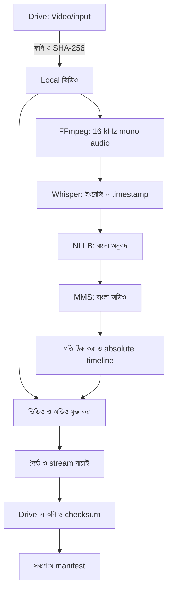

# সিস্টেমের স্থাপত্য

## ১. পরিধি

ইংরেজি কথাসহ ভিডিও থেকে বাংলা dubbing তৈরি হয়। Input: `mp4`, `mkv`, `mov`, `webm`, `avi`, `m4v`। Output: MP4, ইংরেজি/বাংলা SRT এবং পরীক্ষার জন্য JSON। প্রথম non-cover-art video stream ও প্রথম audio stream ব্যবহৃত হয়।

নির্ভুলতা, গতি ও কম memory ব্যবহারের মধ্যে সমন্বয় করা হয়েছে। Speaker আলাদা করা, voice cloning, lip-sync, background music আলাদা করা বা subtitle ছবিতে বসানো এই সংস্করণে নেই।

## ২. Notebook ও worker আলাদা রাখা

Notebook-এ একটি code cell: **Setup ও App চালু করুন**। Colab form view-তে processing code লুকানো থাকে; Run দিলেই setup, mount, settings ও worker পরপর চলে। আলাদা markdown/setup/processing cell নেই। **Show code** দিয়ে source দেখা সম্ভব—এটি গোপন code রাখার ব্যবস্থা নয়।

```text
Colab kernel: হালকা setup → Drive mount → settings → worker চালানো
                                     │
                      প্রতিবার নতুন Python process
                                     ↓
নিজস্ব venv: FFmpeg → ASR → অনুবাদ → TTS → timeline → mux → প্রকাশ
                                     │
                              process বন্ধ হয়
```

### পুনরায় চালানোর ব্যবস্থা

পুরোনো বিন্যাসে প্রতিবার setup kernel-এর ব্যবহৃত package বদলাতে পারত। একই kernel-এ ML চালালে আগের import/CUDA state-ও থেকে যেতে পারত। নির্দিষ্ট ব্যবহারকারীর traceback ছাড়া এগুলোকেই তাঁর error-এর নিশ্চিত কারণ বলা যায় না; নতুন বিন্যাস এই দুই ঝুঁকি এড়ায়।

- `/content/proxmax-app/venv`-এ `--system-site-packages --without-pip` দিয়ে environment তৈরি হয়। Colab-এর torch/CUDA ও pip দেখা যায়; নতুন inference package শুধু নিজস্ব venv-এ install হয়। Kernel-এ torch/transformers import করা হয় না।
- সফল setup-এর fingerprint রাখা হয়। একই requirements/Python এবং উপযুক্ত installed version থাকলে `pip install` বাদ যায়। পরীক্ষা হয় আলাদা interpreter-এ, kernel-এর পুরোনো module cache থেকে নয়।
- অসম্পূর্ণ install-এর completion marker থাকে না; পরের run আবার চেষ্টা করে। Requirements বদলালে setup পুনরায় যাচাই হয়।
- প্রতিটি অনুবাদ run নতুন process পায়। শেষ/ব্যর্থ হওয়ার পর process বন্ধ হয়; পরের worker পুরোনো CUDA context পায় না। এটি ভাঙা driver, অপর্যাপ্ত GPU memory বা network সমস্যা নিজে ঠিক করে না।
- Config stdin pipe দিয়ে worker-এ যায়; structured result stdout pipe দিয়ে memory-তে ফেরে। Parent protocol JSON লুকিয়ে শুধু মানুষের পড়ার মতো progress/error দেখায়। কোনো config/result/log ফাইল লেখা হয় না; প্রতি run-এর outcome নতুন করে শুরু হয়, তাই পুরোনো সফল ফলাফল পুনর্ব্যবহার হয় না।
- Notebook interrupt করলে process group-এ SIGTERM দেওয়া হয়; প্রয়োজন হলে SIGKILL। Worker ও তার FFmpeg subprocess বন্ধ হয়। Checkpoint মুছে ফেলা হয় না।
- Drive-এর mount ও `MyDrive` পড়া যায় কি না যাচাই হয়। সক্রিয় mount পুনর্ব্যবহার হয়; সাধারণ local folder-কে Drive ধরা হয় না। নষ্ট সংযোগে ব্যবহারকারী `REMOUNT_DRIVE=True` করতে পারেন; জোর করে mount ভাঙা হয় না।

Notebook-এর setup helper, pipeline ও worker source notebook-এই থাকে। Repository clone বা দূরের executable code আনা লাগে না। নতুন notebook generate করলে তিনটি source-ই হালনাগাদ হয়।

## ৩. ডেটার প্রবাহ ও অবস্থান



| অবস্থান | কী থাকে |
|---|---|
| `/content/drive/MyDrive/Video/input` | ব্যবহারকারীর মূল ভিডিও |
| `/content/proxmax-work/<job>` | local video, WAV, checkpoint, clip ও output |
| `/content/proxmax-model-cache` | model/tokenizer cache |
| `/content/proxmax-app` | venv ও embedded source; error/log ফাইল নয় |
| `/content/drive/MyDrive/Video/output/<job>` | সম্পন্ন ফলাফল |

ভারী কাজ local file নিয়েই হয়। Input কপি করার সময়েই hash হয়, আলাদা করে Drive থেকে আবার পুরো input পড়তে হয় না। Output checksum যাচাইয়ের জন্য Drive-এ লেখা temporary file পড়া হয়; নির্ভরযোগ্যতার জন্য এই অতিরিক্ত I/O রাখা হয়েছে।

## ৪. Pipeline-এর ধাপ

### ক. ভিডিও আনা ও audio extraction

- সমর্থিত extension-এর ভিডিও সরাসরি input folder থেকে নেওয়া হয়; subfolder নয়।
- input/output/work path আলাদা রাখা, খালি disk এবং পরিবর্তনশীল input যাচাই করা হয়। 6 GiB margin ও media-ভিত্তিক অনুমান ব্যবহৃত হয়; এটি সব আকারের ভিডিওর storage নিশ্চয়তা নয়।
- Job ID-তে নিরাপদ filename, content hash, inference setting ও package version-এর hash থাকে।
- local input-এ ffprobe চলে; finite duration ও ভিডিও stream প্রয়োজন। Audio stream না থাকলে স্পষ্ট error হয়।
- FFmpeg mono PCM16, 16 kHz তৈরি করে। `aresample=async=1:first_pts=0` দিয়ে audio delay/ফাঁক সামলানো হয়। গুরুতর নষ্ট বা discontinuous timestamp আগে মেরামত করতে হতে পারে।

### খ. ইংরেজি speech recognition

Model: `mobiuslabsgmbh/faster-whisper-large-v3-turbo`—[faster-whisper v1.2.1-এর registry](https://github.com/SYSTRAN/faster-whisper/blob/v1.2.1/faster_whisper/utils.py) অনুযায়ী। পুরোনো ভুল `Systran/faster-whisper-large-v3-turbo` এবং `turbo`/`large-v3-turbo` alias সংশোধন করা হয়। `language="en"`, `task="transcribe"`; Whisper-এর translation mode নয়।

- ASR, অনুবাদ ও TTS-এর public download-এ `token=False`; পুরোনো invalid cached token ব্যবহার হয় না। Worker implicit token-ও বন্ধ রাখে। Private/gated model-এর authentication এই সংস্করণের বাইরে। ASR-এ HTTP 401/403/404 হলে model ID/revision-সহ স্পষ্ট error ও original traceback দেখায়, নীরবে অন্য model ব্যবহার করে না।
- FFmpeg-এর তৈরি 16 kHz mono WAV `soundfile` দিয়ে contiguous `float32` array হিসেবে পড়া হয়। Sample rate, channel, খালি audio ও NaN/Inf যাচাইয়ের পরে সেই array Whisper-এ যায়; PyAV দিয়ে একই file আবার decode হয় না। এতে `av.open(metadata_errors=...)` API mismatch-এর পথটি এড়ানো হয়।
- Dependency সামঞ্জস্যের জন্য `av==16.0.1` pin করা হয়েছে; এই সংস্করণে `metadata_errors` আছে এবং Python 3.13 Linux wheel-ও পাওয়া যায়। PyAV-এর সংস্করণও output manifest-এর package তালিকায় থাকে।
- CUDA-তে পছন্দ `int8_float16`, CPU-তে `int8`; প্রয়োজন হলে সমর্থিত floating-point type।
- Word timestamp, beam size 5, VAD এবং 500 ms silence threshold।
- আগের text-এর conditioning বন্ধ, যাতে repetition ছড়ানোর ঝুঁকি কমে; কিছু দীর্ঘ context হারায়।
- বাক্যের শেষে, 0.65 সেকেন্ড বিরতিতে, 12 সেকেন্ড লক্ষ্যসীমা বা 40 word-এ phrase ভাগ হয়। একটি অস্বাভাবিক দীর্ঘ word/fallback segment-এর জন্য নতুন timestamp বানানো হয় না।
- Word probability ও segment diagnostic `asr.json`-এ থাকে; এগুলো নিশ্চিত accuracy score নয়।
- নীরব/অতি ক্ষীণ কথায় VAD ভুল করতে পারে। কোনো কথা না পেলে নীরব output ও warning হয়।

### গ. বাংলা অনুবাদ

Model: `facebook/nllb-200-distilled-600M`; `eng_Latn → ben_Beng`।

- Bengali target token বাধ্যতামূলক; default batch 4, beam 3। GPU FP16, CPU FP32।
- অতিরিক্ত source token চুপচাপ কাটা হয় না। Generation limit ছুঁলে forced EOS থাকলেও সম্ভাব্য অসম্পূর্ণ অনুবাদ হিসেবে error হয়।
- খালি বা Bengali-script বিহীন ফলাফল গ্রহণ করা হয় না। Script check মানেই সঠিক অর্থ নয়।
- সম্পন্ন ধাপ `translation.json`-এ লেখা হয়; তারপর model unload হয়।

ছোট phrase timeline ও memory-র সুবিধা দেয়, কিন্তু document context সীমিত হয়। নাম, সংখ্যা, বিষয়ভিত্তিক শব্দ ও বাগ্‌ধারা বাংলা জানা কাউকে দিয়ে যাচাই করতে হবে।

### ঘ. বাংলা speech synthesis

Model: `facebook/mms-tts-ben`, Transformers VITS।

- নিজস্ব একটি কণ্ঠ; hosted TTS service বা key লাগে না। Tokenizer চাইলে reusable `uroman` দিয়ে romanization হয়।
- সর্বোচ্চ 220 character-এর word/sentence-ভিত্তিক chunk; কথা বাদ পড়ে না। খুব বড় একক token হলে error হয়।
- VITS স্থিতিশীলতার জন্য FP32-তে চলে। Seed phrase-ভিত্তিক; অন্য hardware/version-এ একই byte-এর output নিশ্চিত নয়।
- খালি, নীরব বা nonfinite waveform error দেয়। Peak বেশি হলে কমানো হয়; এটি পূর্ণ loudness normalization নয়।
- প্রতিটি fitted clip-এর text/timing/recipe signature ও checksum থাকে। অনুবাদের একটি phrase বদলালে শুধু সেই clip পুনরায় তৈরি হয়।

### ঙ. সময় মেলানো

```text
start       = ইংরেজি phrase-এর শুরুর সময়
slot_end    = min(ভিডিওর শেষ, পরের phrase-এর শুরু, phrase-এর শেষ + 0.30 সেকেন্ড)
slot_length = round(slot_end × sample_rate) − round(start × sample_rate)
speed       = max(1, বাংলা অডিওর দৈর্ঘ্য / slot-এর দৈর্ঘ্য)
```

- শুধু পরের অব্যবহৃত silence থেকে সর্বোচ্চ 0.30 সেকেন্ড নেওয়া হয়; পরের phrase-এর সঙ্গে overlap নয়।
- ছোট speech স্বাভাবিক গতিতে থাকে; শেষে silence বসে। বড় speech-এর জন্য pitch-preserving `atempo`, 0.5–2.0 ধাপে ভাগ করা হয়।
- Default `stretch` পূর্ণ speech রাখে; 1.50× ছাড়ালে review flag দেয়। `error` mode অতিরিক্ত গতি চাইলে থামে।
- `atempo` sample-exact নয়। প্রয়োজন হলে অল্প বেশি গতিতে bounded retry হয়; **শব্দ কেটে fit করা হয় না**।
- প্রতিটি clip নিজের absolute sample position-এ disk-backed int16 timeline-এ বসে। Overlap ও video boundary যাচাই হয়।
- WAV 30 সেকেন্ডের block-এ লেখা হয়। এতে পুরো output audio RAM-এ রাখতে হয় না; Whisper-এর input audio কিন্তু RAM ব্যবহার করে।

এটি phrase-onset alignment, lip-sync নয়। অনুবাদে শব্দের ক্রম/দৈর্ঘ্য বদলায়; মুখের প্রতিটি নড়াচড়া মেলানো হয় না।

### চ. ভিডিও তৈরি ও প্রকাশ

- H.264 stream সম্ভব হলে copy; অন্য codec বা copy ব্যর্থ হলে `libx264`, `veryfast`, CRF 20, YUV420p।
- বাংলা mono AAC, 96 kb/s, language `ben`; MP4 fast-start। মূল ইংরেজি/গান/পরিবেশের audio রাখা হয় না। পুরোনো subtitle, metadata ও chapter কপি হয় না।
- video/audio stream ও মোট duration যাচাই করা হয়; packet/frame rounding-এর জন্য 250 ms tolerance। শুধু container duration দিয়ে বাস্তব speech sync যাচাই হয় না।
- Output, subtitle ও JSON temporary sibling-এ কপি করে checksum মেলানো হয়, তারপর rename। **সবশেষে `manifest.json`** লেখা হয়।

Manifest-last একটি completion protocol, বহু ফাইলের atomic transaction নয়। পুনরায় প্রকাশের আগে পুরোনো completion marker সরানো হয়। Mount checksum server-side তাৎক্ষণিক durability বা একসঙ্গে একাধিক writer-এর নিরাপত্তা নিশ্চিত করে না।

## ৫. Resource ও recovery

এক সময়ে এক model এবং এক ভিডিও চলে। Stage শেষে model মুছে garbage collection/PyTorch cache পরিষ্কার হয়; batch শেষে worker-ই বন্ধ হয়। বারবার model load-এর কিছু সময় লাগে, কিন্তু একসঙ্গে GPU-তে সব model থাকে না।

Checkpoint-এর ক্রম:

```text
local input → asr.json → translation.json → clips/*.wav + metadata
                                           → timeline → mux → Drive
```

- JSON-এ temporary write ও rename। অসম্পূর্ণ ASR/translation ধাপ পুরোটা আবার চলে; TTS clip ধরে resume করে।
- Operational path/cleanup/timeout বদল inference recipe বদলায় না। Content বা inference setting বদলালে আলাদা job।
- বাস্তবে ব্যবহৃত model commit manifest-এ থাকে। Default `main` ভবিষ্যতে বদলাতে পারে; reproducibility চাইলে `*_revision` pin করুন।
- নষ্ট JSON/timestamp error দেয়; নীরবে উপেক্ষা করে না। প্রয়োজন হলে সংশ্লিষ্ট local checkpoint সরিয়ে আবার তৈরি করুন।
- `keep_local=True` থাকলে local `translation.json`-এর শুধু `bangla` field সংশোধন করা যায়। ID/time বদলাবেন না।
- ব্যর্থতার stage/error ও traceback terminal-এ আসে; `failure.json`, `batch_results.json` বা run log লেখা হয় না। Checkpoint থাকে, error report নয়। পরের ভিডিও default-ভাবে চলতে পারে। সফল local job কেবল verified publication-এর পরে মুছে যায়।
- সফল output থাকলেই পরের run সেটি বাদ দেয় না। Input hash আবার যাচাই হয়; checkpoint না থাকলে কাজ আবার হয়।
- Runtime হারালে venv, model cache ও local checkpoint হারায়। Drive-এর সম্পন্ন ফলাফল থাকে। Checkpoint ক্রমাগত Drive-এ sync করা হয় না, যাতে latency না বাড়ে।

Core package pin আছে, সম্পূর্ণ Colab image lockfile নয়। বর্তমান stack CUDA 12/cuDNN 9 লক্ষ্য করে। Colab image বদলালে বাস্তব পরীক্ষা ও প্রয়োজনমতো pin বদল জরুরি। CPU mode স্পষ্টভাবে বেছে নেওয়া যায়; error ঢাকতে নীরবে model/device বদলানো হয় না।

Manifest-এর stage time কেবল বর্তমান run-এর সময়—cache hit-সহ। Download, warm inference ও resume-এর সময় আলাদা না করে benchmark তুলনা করবেন না। নির্দিষ্ট speed/accuracy দাবি করা হয়নি।

## ৬. নিরাপত্তা, লাইসেন্স ও পরীক্ষা

- Drive authentication Colab পরিচালনা করে। Credential code-এ রাখা হয় না।
- Model download ছাড়া inference-এর জন্য speech/text বাইরের API-তে পাঠানো হয় না; Colab নিজেই cloud VM।
- `trust_remote_code=False`, torch 2.6+; FFmpeg argument-list দিয়ে চলে, filename shell-এ বসানো হয় না।
- Transcript, local checkpoint, terminal output ও ভিডিও ব্যক্তিগত তথ্য বহন করতে পারে। প্রকাশ্য repository-তে রাখবেন না।
- NLLB/MMS-এর CC-BY-NC-4.0 non-commercial সীমা প্রযোজ্য; code license সেটি বদলায় না। Model card-এর link README-তে আছে।

Test suite ও test-only CI repository থেকে সরানো হয়েছে। Source বদলানোর পরে `python scripts/build_notebook.py --check` দিয়ে notebook হালনাগাদ আছে কি না দেখুন। বাস্তব ব্যবহার যাচাই করতে Colab-এ ছোট ভিডিও দিয়ে model download, GPU/CPU, বাংলা উচ্চারণ, timing ও Drive output পরীক্ষা করুন; source validation দিয়ে এগুলো নিশ্চিত হয় না।
